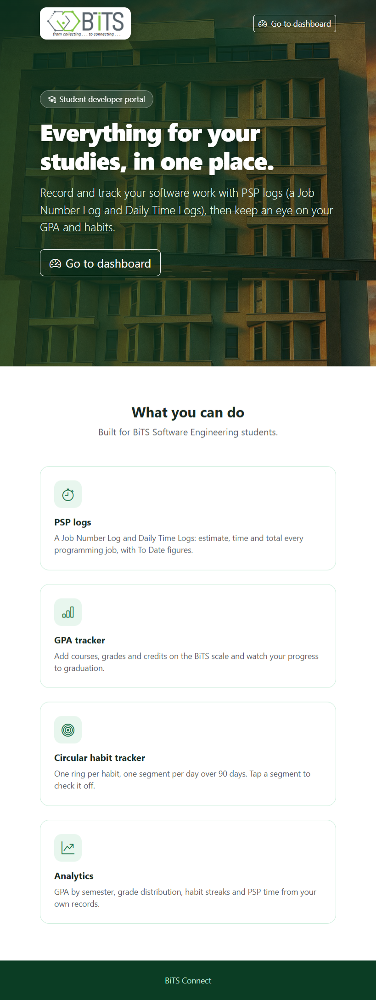
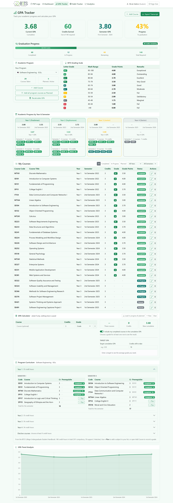
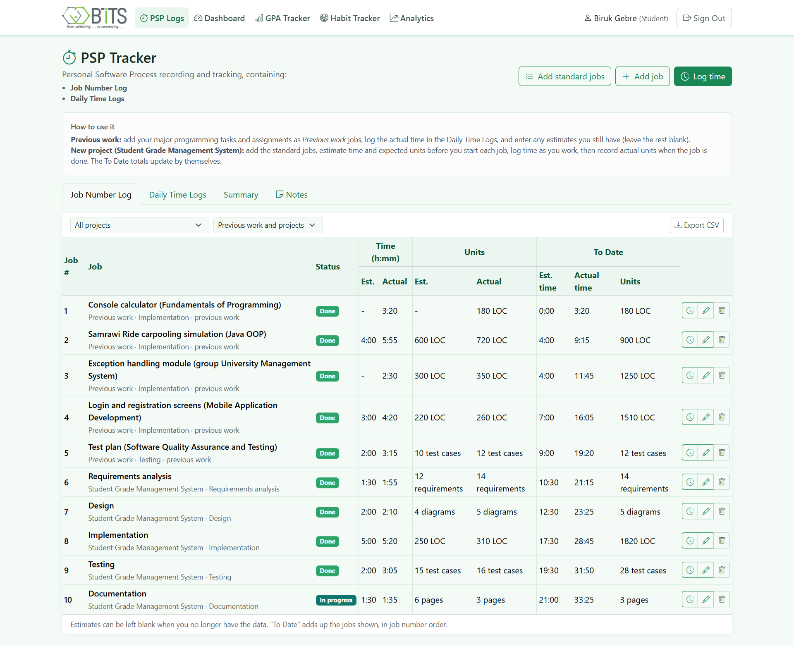
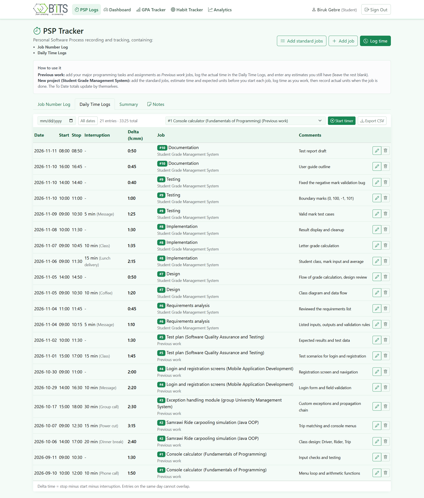
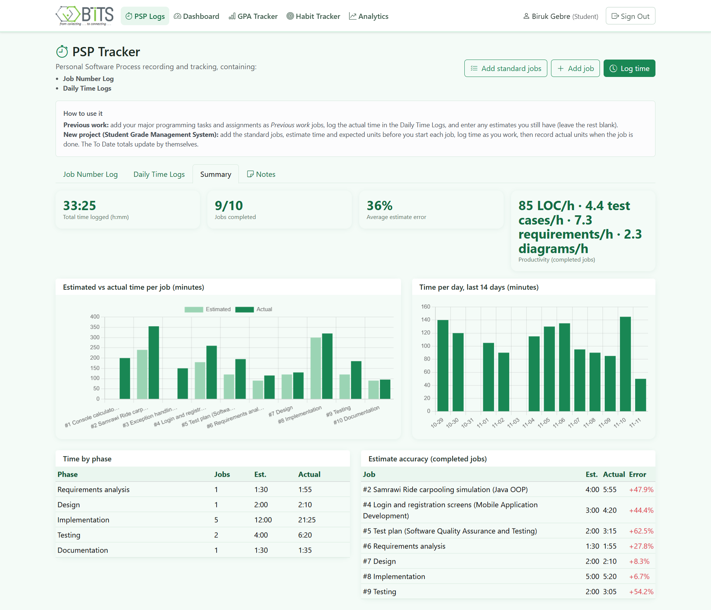
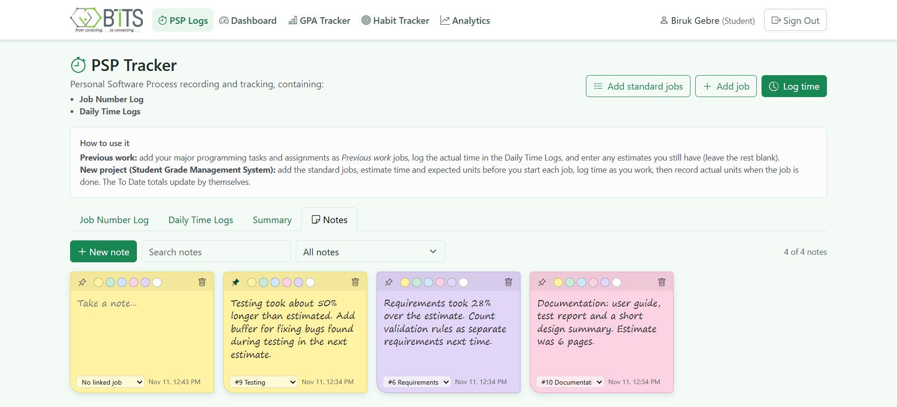
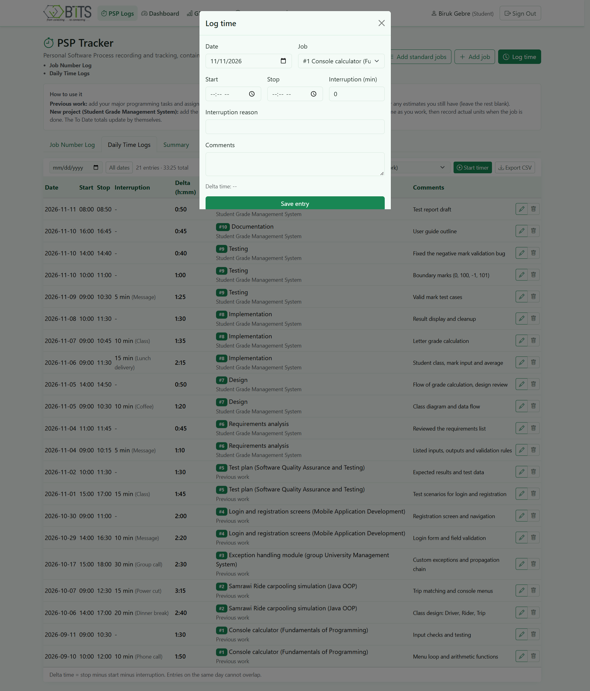
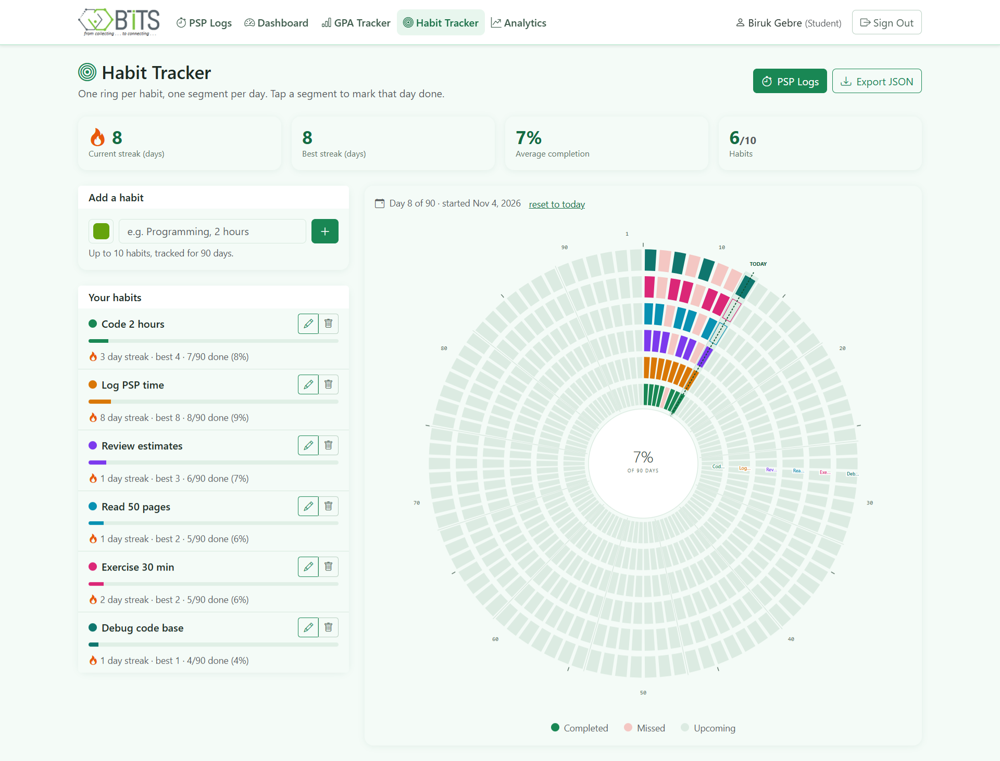
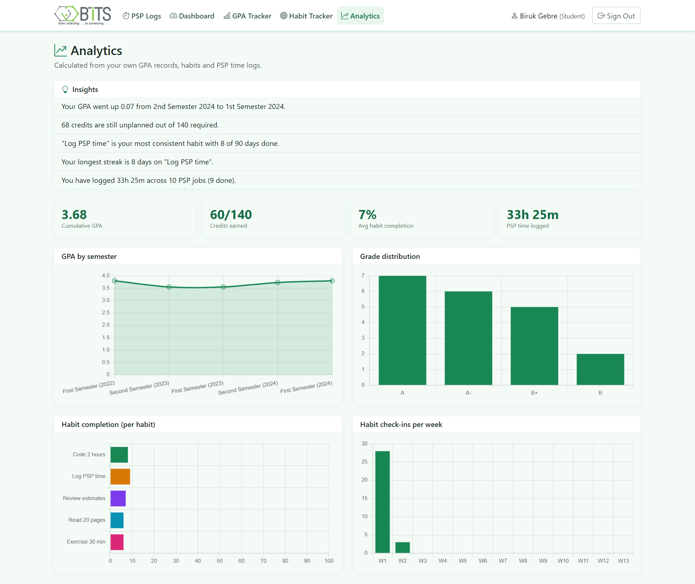

# BiTS Connect
 Biruk_Gebre_UGR-SWE-0113-24


<p align="center">
  <strong>A Student Developer Portal for BiTS College</strong>
</p>

<p align="center">
  A platform featuring Personal Software Process (PSP) tracking, GPA management, habit tracking, and academic analytics.
</p>

---

**Author:** Biruk Gebre | Software Engineering | BiTS College, Addis Ababa

## Screenshots

### 1. Home Page



### 2. Student Dashboard


### 3. GPA Tracker




### 4. Personal Software Process (PSP) Tracker











### 5. Habit Tracker



### 6. Analytics Dashboard



---

## Features

- **PSP Tracker**
  - Job Number Log.
  - Daily Time Logs.
  - Estimated vs. actual time tracking.
  - Productivity metrics.
  - CSV export.
  - Sticky notes linked to jobs.

- **GPA Tracker**
  - Course and credit management.
  - Semester, yearly, and cumulative GPA calculations.
  - BiTS Software Engineering curriculum.
  - What-if GPA calculator.
  - Target-GPA planner.

- **Habit Tracker**
  - 90-day habit tracking.
  - Streak tracking.
  - JSON export.
  - Support for up to 10 habits.

- **Dashboard and Analytics**
  - GPA trends.
  - Grade distribution.
  - Habit completion.
  - PSP time analytics.

## Demo Account

A demo student account is created automatically when the database is initialized.

- **Email:** `biruk.gebre@bits.edu`
- **Password:** `demo12345`

The demo account includes sample PSP records, GPA data, and habits.

Set `NO_DEMO=1` to start with an empty database, or run:

```bash
npm run seed -- --reset
```

You can also register your own account.

## Installation and Setup

### Requirements

- Node.js 22.13 or newer.
- npm.

### Clone the repository

```bash
git clone https://github.com/birukG09/Bits-psp-v2.0.git
cd Bits-psp-v2.0
```

### Install dependencies

```bash
npm install
```

### Start the application

```bash
npm start
```

Open your browser:

```text
http://localhost:3000
```

To change the port:

```bash
PORT=4000 npm start
```

## Technology Stack

- **Backend:** Node.js, Express.js
- **Frontend:** HTML, CSS, JavaScript, Bootstrap
- **Database:** SQLite
- **Data Visualization:** Chart.js
- **Icons:** Bootstrap Icons

## Project Structure

```text
Bits-psp-v2.0/
│
├── public/
│   ├── assets/
│   │   ├── css/
│   │   ├── img/
│   │   └── js/
│   ├── index.html
│   ├── dashboard.html
│   ├── login.html
│   ├── analytics.html
│   ├── gpa-tracker.html
│   ├── habit-tracker.html
│   └── psp-logs.html
│
├── server/
│   ├── analytics.js
│   ├── auth.js
│   ├── curriculum.js
│   ├── db.js
│   ├── gpa.js
│   ├── habits.js
│   ├── psp.js
│   ├── scale.js
│   └── index.js
│
├── data/
├── package.json
└── README.md
```

## Author

**Biruk Gebre**

Software Engineering Student | BiTS College

GitHub: https://github.com/birukG09
